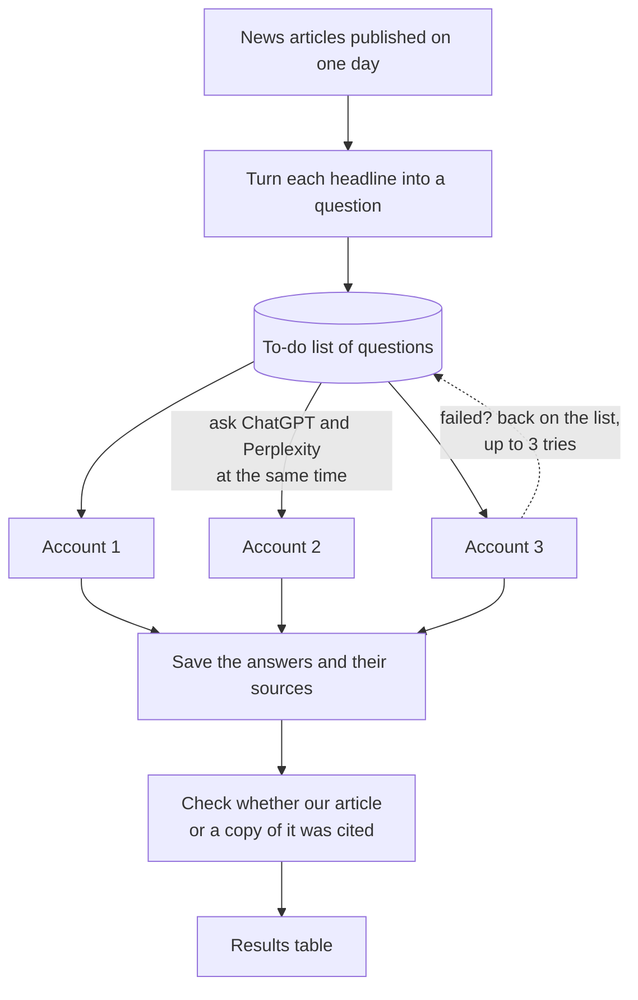

# llm-evidence-gathering

Measures whether ChatGPT and Perplexity cite Gannett articles when asked about them. For each article, the pipeline asks both chatbots a question built from the headline, then records the answer, the cited sources and the pages the chatbot retrieved.

## How it works



**Working in parallel.** All questions go on one to-do list. Each account takes the next question as soon as it is free, so several questions are asked at the same time; more accounts make the run faster. ChatGPT and Perplexity run side by side, each with its own accounts.

**Trying again.** If a question fails, for example because the page did not load, it goes back on the list and is asked again 2 minutes later, possibly by a different account. After 3 failed tries it is marked as failed and kept in the results as an empty row, so no article goes missing. If a whole run stops halfway, starting it again picks up where it left off.

One command, `python run.py`, does all of this.

> **Before you start: set up each account by hand once.** For every Google account you put in `accounts.toml`, sign in to ChatGPT and to Perplexity in a normal browser, create the account if asked, and click through every new-user screen (welcome tours, onboarding questions, feature announcements, cookie banner). The scraper only handles the screens it knows; an unexpected onboarding page can cover the chat box and make every article fail.

## Layout

| Folder | Contents |
|---|---|
| `run.py` | The one command to run everything |
| `scraper/` | Browser scrapers for ChatGPT and Perplexity, account logins, and the parallel queue |
| `ingest/` | Inputs: Gannett Content API export (`Gannett_API.py`), prompt generation (`Prompt_Generator.py`), sample API queries and a sample dataset |
| `analysis/` | `Analysis_Metrics.py` and the baseline-graphs notebook |
| `tools/` | `make_test_input.py` (used by `run.py` for test runs); `capture_page_samples.py` saves page snapshots for debugging |
| `history/` | Deprecated scrapers, kept for reference (see `history/README.md`) |

Not in git: `accounts.toml` (credentials), `profiles/` (browser sessions), `data/` (inputs, results, logs, screenshots).

## Setup

```
python3 -m venv venv
source venv/bin/activate
pip install -r requirements.txt
cp accounts.example.toml accounts.toml     # then fill in real accounts
export OPENAI_API_KEY=sk-...               # used to generate prompts
export GANNETT_API_KEY=...                 # used to fetch articles for a date
```

Chrome must be installed.

## Run

```
python run.py
```

That is all. It asks a few questions (press Enter to accept the default shown in brackets). The run name defaults to **yesterday's date**, the latest day whose articles are all published; `today`, `yesterday`, a date, or a range like `2026-10-20_22` also work. Any other name is a test run on sample articles. It also points out unfinished runs so you can resume them. Then it:

1. gets the input: an existing file in `data/<name>/`; for a date, the Gannett API (needs `GANNETT_API_KEY`; sample articles are never used for a date); for any other name, a test sample from `ingest/dataset.csv`
2. checks every account in `accounts.toml` is logged in on each site, logging in again automatically when needed; a browser window opens only if Google wants a manual step
3. runs ChatGPT and Perplexity at the same time, one worker per account, with retries
4. prints a summary and offers to run `analysis/Analysis_Metrics.py` on the results

It switches to the project's `venv` by itself, so `python3 run.py` works without activating it. Ctrl+C stops a run; running it again with the same name resumes.

Answers can also be given as options, for example:

```
python run.py --yes                                        # yesterday, both sites, no questions (good for a daily schedule)
python run.py --name 2026-10-20 --sites both --yes          # a specific date
python run.py --name mytest --test-articles 6 --yes         # quick test without an API key
python run.py --name 2026-10-20 --retry-failed              # re-run articles that failed
```

`python run.py --help` lists every option.

## Output files

Each run gets its own folder, named after the run, with one subfolder per site:

```
data/<name>/
    gannett_API_data_<name>.csv              input
    chatgpt/
        gannett_chatgpt_<name>.csv           one row per article -> analysis/Analysis_Metrics.py
        gannett_chatgpt_<name>_raw.csv       one row per attempt, failed ones included
        analysis_summary_chatgpt_<name>.csv  written when you let run.py run the analysis
        queue.db                             needed to resume, retry or re-export; keep it
        logs/                                one log per worker
        screenshots/                         matches found; errors in screenshots/Errors/
    perplexity/
        (same files)
```

The per-article file includes failed articles with empty results, in the same layout as the original scrapers' output, so `analysis/Analysis_Metrics.py` reads it directly. To delete a run, delete its folder; to redo one site, delete `data/<name>/<site>/`.

## Testing the parallel run

A walkthrough to check the whole pipeline on a handful of articles: logins, parallel workers, retries, crash recovery and resume. It needs no Gannett API key. Plan on about 15 minutes.

### 1. Prepare accounts

Add accounts to `accounts.toml`. Each needs to be a Google account, set up by hand first (see "Before you start" at the top); both sites log in with "Continue with Google". Accounts without two-step verification work best. Passkeys are handled automatically.

How many accounts:

| Accounts | What you can test |
|---|---|
| none | ChatGPT only, with `--guest`: one logged-out worker. Perplexity refuses logged-out use |
| 1 | Everything except parallelism: one worker runs the articles one after another; retries, crash recovery and resume all work |
| 2 or more | Parallel runs on both sites |

The first run logs each account in on each site, about 40 to 60 seconds each, and saves the session under `profiles/<account>/<site>/`. Later runs reuse it. If Google asks for a phone confirmation or a code, a browser window opens; finish the step there and press Enter in the terminal.

### 2. Run a test

```
python run.py --name partest --test-articles 6
```

This creates `data/partest/` with 6 articles from the sample dataset, checks the logins, and runs both sites. One worker starts per account, 15 seconds apart. Worker names are `w<number>-<account>`. Progress prints every 20 seconds, prefixed by the site (example with two accounts):

```
Checking logins...
  chatgpt/acct1: ok (7s)
  chatgpt/acct2: ok (7s)
  perplexity/acct1: ok (5s)
  perplexity/acct2: ok (6s)

[chatgpt   ] started w1-acct1 (pid 52736) -> data/partest/chatgpt/logs/w1-acct1.log
[chatgpt   ] started w2-acct2 (pid 52776) -> data/partest/chatgpt/logs/w2-acct2.log
[perplexity] started w1-acct1 (pid 53672) -> data/partest/perplexity/logs/w1-acct1.log
[chatgpt   ] 21:42:01 {'pending': 4, 'running': 2, 'done': 0, 'failed': 0} | 20s
...
=== Summary ===
chatgpt    6 articles | {'done': 6} | original cited in 0/6 | data/partest/chatgpt/gannett_chatgpt_partest.csv
perplexity 6 articles | {'done': 6} | original cited in 4/6 | data/partest/perplexity/gannett_perplexity_partest.csv
```

Expected: every article ends as `done`, about 20 to 30 seconds per article plus a 20 to 30 second pause between articles per worker. Each worker's log in `data/partest/<site>/logs/` shows which articles it took and how many citations and search results it found.

Without `OPENAI_API_KEY` the run notes that prompts use the template "What can you tell me about: <headline>". That is fine for testing.

### 3. Test crash recovery

Start a new test, and while a worker is busy, kill it from a second terminal:

```
python run.py --name killtest --test-articles 4 --sites chatgpt
# second terminal, once the progress shows 'running' above 0
# (use a worker name from the "started ..." lines, e.g. w2-acct2):
pkill -9 -f "worker-id w2-acct2"
```

Expected within about 20 seconds: `w2-acct2 exited with -9; released 1 task(s); restart 1`. This works with a single account too; kill `w1-<account>`. The restarted worker re-runs the interrupted article and the run still ends with every article `done`.

### 4. Test resume and retry

Run the same command again:

```
python run.py --name killtest --sites chatgpt
```

Expected: `Nothing to do.` Finished articles are never re-run. If a run ends with failed articles, add `--retry-failed` to put them back in the queue.

Failed attempts retry automatically within a run: up to 3 tries per article, 2 minutes apart, possibly on another worker. Every attempt, failed or not, is a row in `data/<name>/<site>/gannett_<site>_<name>_raw.csv`; error screenshots go to `data/<name>/<site>/screenshots/Errors/`.

### 5. Start a test over

```
rm -rf data/partest
```

### Troubleshooting

| Symptom | Fix |
|---|---|
| `cannot connect to chrome` or a profile seems locked | A browser from an earlier run is still open on that profile. Close it, or stop the earlier run with Ctrl+C. |
| `login_challenge` in a worker log, worker stops | Google wants a manual step. Run `python run.py` again with the same name: the login check opens a browser for that account; finish the step there and the run resumes. |
| `Google rejected the email or password` | Check that account in `accounts.toml`. |
| `web search item disabled; reloading` in a ChatGPT log | Normal; ChatGPT sometimes loads the menu late. The worker reloads and continues. |
| Articles keep failing with the same error | Look at the screenshots in `data/<name>/<site>/screenshots/Errors/`; the site layout may have changed. `python tools/capture_page_samples.py <site> --profile <account>` saves the current page for debugging. |

## Output columns

The per-article file has, in order: every column of the input file (including `fullText` and `section`), the columns of the original scrapers, then new columns.

Original columns, ChatGPT:

| Column | Meaning |
|---|---|
| `prompt`, `response_text`, `request_time`, `screenshot_path` | Question asked, answer (HTML), time asked, screenshot when a match was found |
| `response_citations` | Sources cited in the answer (JSON list) |
| `response_search_results` | Pages ChatGPT retrieved, cited or not (JSON list) |
| `original_in_citations`, `original_in_search_results` | 1 if a source URL is contained in the article URL |
| `republisher_in_citations`, `republisher_in_search_results` | 1 if a source title (cut at " ...") is contained in the article headline, on another URL, not Wikipedia |

Original columns, Perplexity:

| Column | Meaning |
|---|---|
| `prompt`, `response_text`, `request_time`, `screenshot_path` | As above |
| `number_of_sources` | The count on Perplexity's "N sources" button |
| `response_sources` | The site of each source, cut after the domain, e.g. `['usatoday.com', 'people.com']` |
| `original_in_sources` | 1 if one of those sites appears in the article URL (site-level match, as before) |

The matching rules are the original scrapers' rules, unchanged, so results stay comparable with earlier runs. Perplexity also gets the ChatGPT-style columns (`response_citations`, `original_in_citations`, ...) as new columns.

New columns, both sites:

| Column | Meaning |
|---|---|
| `status`, `last_error`, `tries` | Final status, last error if it failed, retries used |
| `n_citations`, `n_search_results`, `n_search_results_not_cited` | Counts of cited sources, retrieved pages, and retrieved pages not cited |
| `search_results_status` | `ok`, `none`, `partial (x/N)` or `capture_failed` |
| `response_plain`, `response_images` | Answer as plain text; image cards shown in the answer |
| `account`, `prompt_source` | Account that ran it; `generated` or `fallback` prompt |
